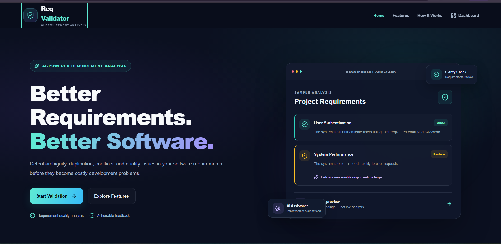
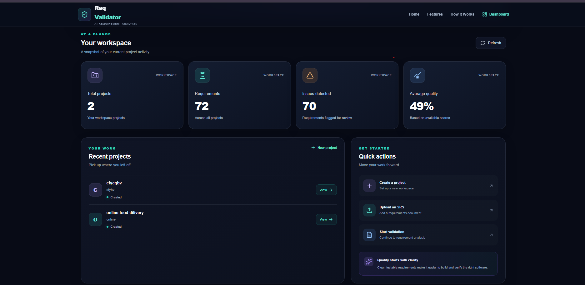
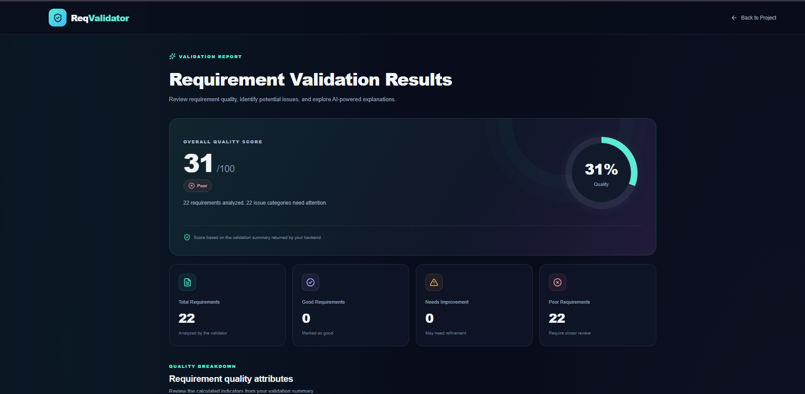

# AI Software Requirement Validator

An AI-powered web application designed to help users validate software requirements, identify inconsistencies and duplicates, and analyze Software Requirements Specification (SRS) documents.

## Overview

The AI Software Requirement Validator provides a centralized platform for managing software projects and reviewing their requirements. It combines a React frontend, a Spring Boot backend, and a Python-based AI service.

## Features

- **User Authentication:** Register and log in securely.
- **Project Management:** Create, view, and manage software requirement projects.
- **SRS Upload:** Upload Software Requirements Specification documents.
- **Requirement Management:** Add and manage individual software requirements.
- **Requirement Validation:** Check requirements for potential issues.
- **Duplicate Detection:** Identify potentially duplicate requirements.
- **Consistency Detection:** Help identify inconsistencies between requirements.
- **AI-Powered Analysis:** Analyze requirements using the configured language-model service.
- **Validation Results:** Review validation results and analysis for your project.

## Technology Stack

| Component | Technologies |
|---|---|
| Frontend | React, Vite, JavaScript, CSS |
| Backend | Java, Spring Boot, Maven |
| AI Service | Python |
| Database | MongoDB |
| Authentication | JWT |
| Version Control | Git and GitHub |

## Project Structure

```text
AI-Software-Requirement-Validator/
├── ai-service/
│   └── main.py
├── backend/
│   ├── pom.xml
│   └── src/
│       └── main/
│           ├── java/
│           └── resources/
├── frontend/
│   ├── package.json
│   └── src/
├── .gitignore
└── README.md
```

## Application Screenshots

### Home Page



### Dashboard



### Validation Results


## Prerequisites

Install the following before running the application:

- Node.js and npm
- Java and Maven (or use the included Maven wrapper)
- Python 3
- MongoDB
- Access to the configured language-model API, if required for AI analysis

## Getting Started

### 1. Clone the repository

```bash
git clone https://github.com/Rakshali-p09/AI-Software-Requirement-Validator.git
cd AI-Software-Requirement-Validator
```

### 2. Start MongoDB

Ensure your MongoDB server is running and the database connection is configured correctly.

The backend's default database URI is:

```text
mongodb://localhost:27017/requirement_validator
```

### 3. Configure the backend

Set the required environment variables before starting Spring Boot:

- `JWT_SECRET` — a strong, randomly generated secret.
- `LLM_API_URL` — the URL of your running AI service.
- `SRS_API_KEY` — your language-model API key.

Keep real credentials out of source control.

### 4. Run the backend

From the project root, run:

```powershell
cd backend
.\mvnw.cmd spring-boot:run
```

The backend is configured to use port `8080` by default.

### 5. Run the frontend

Open a separate terminal:

```powershell
cd frontend
npm install
npm run dev
```

Open the local URL displayed by Vite in your terminal.

### 6. Run the Python AI service

Open another terminal and follow the Python service's dependency and startup instructions. Ensure the service is accessible at the URL configured by `LLM_API_URL`.

## Security Notes

- Never commit API keys, passwords, or production secrets.
- Use environment variables for sensitive configuration.
- Use a unique, strong JWT secret.
- Configure CORS and database access appropriately before deployment.
- Do not expose private documents or uploaded user data in a public repository.

## Future Improvements

- More advanced requirement quality checks.
- Improved reporting and validation summaries.
- Enhanced requirement traceability.
- Deployment and integration testing.

## Author

**Rakshali Patidar**

GitHub: [Rakshali-p09](https://github.com/Rakshali-p09)

## License

No license has been specified yet. All rights are reserved by default unless a license is added to this repository.